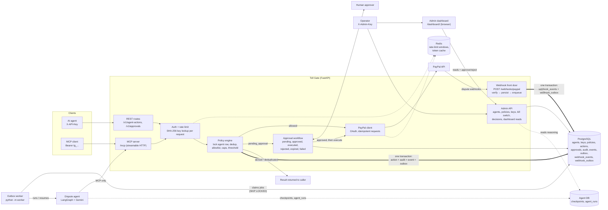
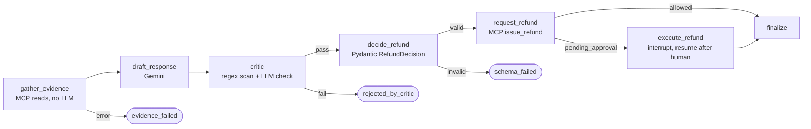
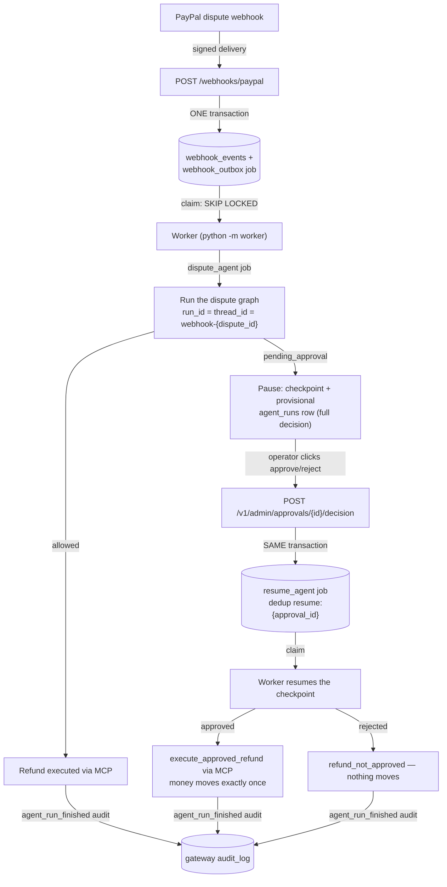

# Toll Gate

A policy gateway between AI agents and PayPal. Agents authenticate with API
keys and *ask permission* to move money; the gateway decides (allow, deny,
require human approval, deduplicate), enforces spending caps atomically,
audits everything, and holds the PayPal credentials so agents never touch
money directly.

On top of that core it also runs the inbound side: PayPal dispute webhooks
land in a signature-verified, deduplicated event log; a background outbox
worker dispatches an autonomous dispute agent (LangGraph + Gemini) per
dispute; and a static admin dashboard at `/dashboard/` lets operators read
the agent's reasoning, approve or reject its proposed refunds, and watch the
resumed run execute. The agent and the dashboard are just two more callers —
real money moves only through the same policy engine.

## Architecture



One process serves both doorways (REST + MCP) plus the webhook front door;
every request re-authenticates against PostgreSQL and Redis, and every
decision lands in one transaction. The worker is a separate, deliberately
poor process: no PayPal credentials, one queue DB, and the same MCP doorway
as any other agent.

Seven subsystems, one repo:

- **Policy engine** (PostgreSQL + Redis): agent identity, per-agent policies,
  atomic spending caps, approval workflow, append-only audit log.
- **PayPal client** (`gateway/paypal_client.py`): OAuth2 token acquisition and
  caching (in-memory or Redis-backed), Orders v2 (create/get/capture),
  captures + full/partial refunds, disputes, idempotency via
  `PayPal-Request-Id`, `Decimal` money as strings, typed error hierarchy with
  `debug_id` logging.
- **MCP server** (`gateway/mcp_server.py`, FastMCP): the same gateway exposed
  to AI agents as Model Context Protocol tools over streamable HTTP at
  `/mcp` — money-moving tools run the full policy engine before touching
  PayPal.
- **Dispute agent** (`agent/`): an autonomous LangGraph agent that consumes
  the MCP server as its only doorway — evidence gathering, LLM-drafted
  dispute responses, a hallucination-checking critic, a schema-validated
  refund decision, and a durable interrupt/resume across human approvals.
  Its production runner lives in the worker (`worker/agent_runner.py`).
- **Webhook pipeline** (`gateway/webhooks.py`): `POST /webhooks/paypal`
  verifies every delivery (PayPal signature API in production, dev HMAC for
  the simulator — fail-closed), persists the raw event, and enqueues the
  worker's job in one transaction.
- **Outbox worker** (`worker/`): `python -m worker` claims `webhook_outbox`
  jobs with `SKIP LOCKED`, runs and resumes the dispute agent, retries
  transient failures with backoff + jitter, dead-letters permanent ones, and
  audits run outcomes back to the gateway.
- **Admin dashboard** (`dashboard/` + `gateway/dashboard.py`): a static
  AG Grid SPA served at `/dashboard/` — five read APIs, one-click
  approve/reject wired to the atomic decision+resume endpoint, cells that
  wrap instead of truncating, and vendored assets so it runs fully offline.

## Data model (10 tables, `gateway/models.py`)

| Table        | Role |
|--------------|------|
| `agents`     | Who may call the gateway (`name` UNIQUE, `is_active` kill switch) |
| `agent_keys` | API-key SHA-256 hashes, 1:N per agent → zero-downtime key rotation; soft revocation (`revoked_at`) keeps rows for forensics |
| `policies`   | One per agent: `allowed_actions` allowlist, `per_txn_cap`, `rolling_24h_cap`, `approval_threshold`, approval TTL. CHECK: threshold ≤ per-txn cap |
| `actions`    | Every authorization request + verdict (`allowed` / `denied` / `pending_approval` / `deduplicated`) with reason code. `execution_failed_at` marks an allowed action whose PayPal execution definitely failed (releases its rolling-cap reservation; the verdict itself is immutable). Partial unique index `(agent_id, idempotency_key) WHERE outcome <> 'deduplicated'` makes double-spending physically impossible |
| `approvals`  | Human-in-the-loop state machine: `pending → approved → executed`, plus `rejected` / `expired` / `failed`; CHECKs enforce timeline consistency |
| `audit_log`  | Append-only record of **every** decision, including auth failures (nullable `agent_id`). FK with no cascade: audit rows block agent deletion |
| `events`     | Immutable domain-event log (JSONB payloads) |
| `outbox`     | Same events with `status` for a publish relay — written in the decision's transaction, so notifications can't be lost to a crash |
| `webhook_events` | Every ACCEPTED PayPal webhook delivery: raw body kept verbatim, verification strategy recorded, UNIQUE `external_event_id` — the first duplicate guard |
| `webhook_outbox` | Job queue for the outbox worker: claimable rows (`pending → processing → processed` / `dead`) with attempts, next-attempt backoff, lease timestamp, last error. Partial unique index `(job_type, dedup_key)` — the second duplicate guard: two DIFFERENT event ids about the SAME dispute enqueue ONE job |

Money is `NUMERIC(12,2)` everywhere; statuses are `TEXT + CHECK` (widening a
CHECK migrates cleanly, unlike `ALTER TYPE`). Schema evolves through Alembic
(`alembic/versions/`, 7 migrations).

## How decisions stay correct under concurrency

`authorize()` (`gateway/policy_engine.py`) takes `SELECT ... FOR UPDATE` on the
agent row first, so concurrent requests from one agent serialize while
different agents never block each other. The rolling 24h cap sums committed
`allowed` actions plus `pending_approval` actions whose approval is still live
— pending approvals *reserve* headroom; rejecting or expiring them releases
it. An `allowed` action whose PayPal execution **definitely** failed (4xx
business rejection — provably not executed) is stamped with
`execution_failed_at` and releases its reservation too; ambiguous failures
(timeouts, 5xx — the money may have moved) keep it, conservatively. Every
decision writes action + audit + event + outbox rows in **one transaction**:
all land or none do. Proven by test: 50 barrier-aligned threads × $10 against
a $100 cap → exactly 10 approvals, total exactly $100.00.

## API

### Agent-facing (auth: `X-API-Key` or `Authorization: Bearer`)

| Endpoint | Purpose |
|---|---|
| `POST /v1/agent-actions` | The decision endpoint. Body: `action_type`, `amount` (decimal **string** — JSON numbers rejected), `currency`, `idempotency_key`, optional `reference_id`. All four outcomes return 200; 4xx means the *request* failed (401/403 auth, 422 validation, 429 rate limit) |
| `GET /v1/actions/{id}` | Action detail (own agent only; foreign ids → 404) |
| `GET /v1/approvals/{id}` | Approval + action detail |
| `POST /v1/approvals/{id}/decision` | `approved` / `rejected` (illegal transitions → 409) |
| `POST /v1/approvals/{id}/execute` | Record execution result: `executed` / `failed` |
| `POST /v1/admin/expire-approvals` | Run the expiry sweep now (pending approvals past `expires_at` → `expired`, releasing cap reservations) |
| `GET /health` | Liveness + `paypal_mode` (never calls PayPal) |

Strict validation (`gateway/schemas.py`): `extra="forbid"` + `strict=True` —
unknown fields, floats-for-money, and malformed values are 422s, mirroring
the DB CHECKs at the edge.

### Admin (auth: `X-Admin-Key` = `ADMIN_API_KEY` env var; unset → 503)

| Endpoint | Purpose |
|---|---|
| `POST /v1/admin/agents` | Provision agent + policy + first key. **Plaintext key returned once, never retrievable again** |
| `PATCH /v1/admin/agents/{id}` | Partial update: the `is_active` kill switch and/or any policy field (allowlist, caps, threshold, TTL). Body needs `actor` (self-reported operator identity, recorded in the audit diff) + ≥1 change field. Deactivation is immediate on every surface — HTTP authorize, all MCP tools, approval execution — and pending approvals are left for the expiry sweep |
| `POST /v1/admin/agents/{id}/keys` | Issue an additional key (rotation: both keys live until the old one is revoked) |
| `DELETE /v1/admin/keys/{key_id}` | Soft-revoke (idempotent). Takes effect on the running server immediately |
| `GET /v1/admin/agents[/{id}]` | Ops views: policy + key prefixes (never hashes) |
| `POST /v1/admin/approvals/{id}/decision` | The human decision path used by the dashboard: same state machine as the agent-facing endpoint (`approved`/`rejected`, row lock, 409 on illegal transitions), **plus** a `resume_agent` job enqueued into `webhook_outbox` in the SAME transaction. Commit-before-you-speak: a recorded decision always implies an (eventual) agent resume, and a resume job can never outlive a rolled-back decision. Dedup key `resume:{approval_id}` makes double-enqueue impossible at the database level |

The admin credential is deliberately an env-var bootstrap secret, **not** an
agent key — agents cannot provision or approve as admins. Because auth does a
fresh DB read per request, keys issued or revoked and agents deactivated or
re-policed through these endpoints are live on the next request with no
restart (verified with a 50-cycle create→use-immediately hammer). Mutating
handlers **commit before returning** so a client acting instantly on a
response can never outrun the commit. Every mutation is audited
(`agent_created` / `agent_updated` / `key_issued` / `key_revoked`) in the
same transaction as the change; `agent_updated` carries the actor and a
before/after diff of exactly the fields that changed.

### Dashboard reads (`/v1/admin/dashboard/*`, auth: `X-Admin-Key` at router level)

Full-fidelity JSON for the SPA — nothing is truncated server-side:

| Endpoint | Purpose |
|---|---|
| `GET /actions` | Recent actions with agent name and the policy snapshot in effect |
| `GET /audit` | Audit feed, filterable by `decision`, `agent_id`, `action_type`, `since`, `until` |
| `GET /approvals` | Approvals (default `status=pending`) joined with the agent DB: the paused run's reasoning, confidence, and cited evidence. The join happens in Python (psycopg) — no cross-DB foreign key — and if the agent DB is unreachable the rows degrade to `agent: null` instead of failing |
| `GET /metrics` | Counters, money totals, median decision latency (`percentile_cont`), agent-run status mix |
| `GET /dead-letter` | Dead worker jobs with the FULL last error, stack traces included |

### Webhook (`POST /webhooks/paypal` — no agent auth; the signature IS the identity)

Two verification strategies, selected by header presence:

- **Production (`paypal`)**: the five `PAYPAL-*` transmission headers, the
  raw body verbatim, and `PAYPAL_WEBHOOK_ID` go to PayPal's
  `verify-webhook-signature` API; only its `SUCCESS` is trusted. Verifier
  unreachable → **502, fail closed** — an unverifiable delivery is not an
  accepted delivery, and PayPal retries on non-2xx.
- **Dev (`shared_secret`)**: an `X-Tollgate-Signature: sha256=<hex>` header —
  HMAC-SHA256 over the exact raw bytes under `WEBHOOK_SHARED_SECRET`. This
  is what `scripts/simulate_dispute.py` sends, so the simulator exercises
  the same endpoint, parsing, and persistence path as production; only the
  crypto check differs.

Bad/missing signature → 401, malformed event → 400, neither strategy
configured → 503. On accept, ONE transaction writes the `webhook_events`
row plus a `webhook_outbox` job (`dispute_agent`, dedup key
`dispute:{id}`) and answers 200 fast — everything else is the worker's job.

### MCP server (`/mcp`, streamable HTTP)

Auth is the same agent API key, sent as `Authorization: Bearer tg_...` (or
`X-API-Key`) on every HTTP request — MCP sessions carry no identity of their
own, so identity is re-resolved (and re-audited on failure) per call.

| Tool | Policy-gated | Purpose |
|---|---|---|
| `get_transaction` | identity only | Fetch a capture by its 17-char ID (status, amount, times) |
| `list_disputes` | identity only | Page through the account's disputes |
| `get_dispute` | identity only | One dispute in full (`PP-D-*` id) |
| `issue_refund` | **full engine** | Refund a capture: allowlist → caps → threshold. `allowed` executes on PayPal immediately with a deterministic `PayPal-Request-Id` (uuid5 of the action id — retries can't double-refund); `pending_approval` creates an approval and moves nothing |
| `create_order` | **full engine** | Create an order (intent=CAPTURE, no money moves); requires `create_order` in the agent's `allowed_actions` |
| `execute_approved_refund` | approval state machine | Executes a refund a human approved (`approved` → PayPal → `executed`/`failed`). Deterministic `PayPal-Request-Id` per action; replaying an executed approval returns the recorded outcome without touching PayPal |

Input schemas are strict: 17-char `[A-Z0-9]` transaction IDs, `PP-D-\d+`
dispute IDs, amounts as positive decimal **strings** (max 2dp), a currency
allowlist (`USD EUR GBP CAD AUD INR`), 8–64-char idempotency keys, and
`additionalProperties: false`. Every result is an envelope
`{"ok": true, "summary": "...", ...}`; denials and pendings are **results**
(`ok: true`, mirroring the HTTP API's "200 for all outcomes"), while auth,
validation, and PayPal failures raise tool errors prefixed with a
`REASON_CODE`. Execution outcomes are audited (`executed` /
`PAYPAL_REFUND_COMPLETED`, `failed` / `PAYPAL_REFUND_FAILED`) and emitted as
`refund.executed` / `refund.failed` events + outbox rows. When a refund's
PayPal execution fails *definitely* (4xx), the action's rolling-cap
reservation is released and the failure audit records
`cap_reservation_released: true`; a same-key replay then reports
`original_execution_failed: true` with a hint to retry under a NEW
idempotency key (decisions replay — they never re-execute).

MCP client configuration (e.g. for any MCP-compatible agent harness):

```json
{"mcpServers": {"tollgate": {
  "url": "http://localhost:8000/mcp",
  "headers": {"Authorization": "Bearer tg_..."}}}}
```

## Dispute agent (`agent/`)

An autonomous agent that handles PayPal disputes end to end. It holds a
regular agent API key (`tg_...`) and talks to the gateway **only** through
the MCP server — it never touches PayPal, the gateway database, or any
state of its own beyond its checkpoints. Every money move therefore passes
the same policy engine, caps, and audit trail as any other agent.

Two generations live side by side:

- `loop_agent.py` — a hand-built prompt→tool-call→tool-output loop
  (registry, Gemini function calling, iteration cap). The mechanics,
  visible.
- `graph.py` — the production shape: a LangGraph `StateGraph`.



The graph only moves forward: every failure branch ends the run with a
terminal status, and only a human approval can wake `execute_refund`.

Guards worth knowing:

- **One-pass critic, no revision loop.** Every 17-char-ID-shaped and
  timestamp-shaped token in the draft must appear verbatim in the evidence
  JSON (deterministic scan), and an LLM fact-check verdict must say
  `supported` — unparseable verdicts fail closed. A rejected draft ends the
  run (`rejected_by_critic`); it is never sent back for rewording, so a
  hallucination cannot be laundered by a rewrite.
- **The decision is a schema, not prose.** `RefundDecision`
  (`extra="forbid"`) enforces the gateway's ID/timestamp regexes, refund > 0
  only with `issue_refund`, cited transaction IDs that exist in the
  evidence, refund ≤ transaction amount, and confidence below the floor ⇒
  `escalate_human`. The floor defaults to 0.6 and is configurable via
  `AGENT_MIN_CONFIDENCE` — a policy default, not a measured value: LLM
  self-reported confidence stays uncalibrated until labeled outcomes
  accumulate (every human approval/escalation is a label). Validation
  failure is a terminal `schema_failed` status.
- **Approval pauses the graph, durably.** `pending_approval` triggers a
  LangGraph `interrupt()`; the state is checkpointed in PostgreSQL
  (`langgraph-checkpoint-postgres`, its own `agent` database). The process
  can die — a fresh process resumes by thread id, calls the gateway's
  `execute_approved_refund`, and finishes. Proven by a test that runs the
  interrupt and the resume in two separate OS processes.
- **Budgets and retries.** Each run gets a `RunMeter`: unique run id, hard
  token budget checked *before* every call, and USD cost from a static
  price table. Transient Gemini failures (429/5xx/network) retry with
  exponential backoff + jitter; 4xx do not.
- Telemetry lands in `agent_runs` (status, in/out tokens, cost, LLM calls,
  plus `confidence` and `proposed_action` — the calibration dataset that
  will let the confidence floor become a measured number) in the agent
  database.

Running it:

```bash
# env: GEMINI_API_KEY, AGENT_API_KEY (the agent's tg_ key), optional:
# AGENT_MODEL (default gemini-3.8-flash), AGENT_MCP_URL, AGENT_DATABASE_URL,
# AGENT_TOKEN_BUDGET, AGENT_PROMPT_VERSION

uv run python -m agent.run_dispute PP-D-56244        # fresh run
# → pauses with an interrupt payload when the gateway demands approval:
#   {"paused": "approval_required", "interrupt": {"approval_id": 4, ...},
#    "resume_with": "uv run python -m agent.run_dispute --resume run-... --approved"}

# human decides the approval via the gateway (POST /v1/approvals/4/decision), then:
uv run python -m agent.run_dispute --resume run-... --approved   # or --rejected
```

That CLI is the manual doorway. In production the same graph runs inside the
outbox worker (`worker/agent_runner.py`): `run_id = thread_id =
webhook-{dispute_id}`, a checkpoint pre-check makes at-least-once dispatch
idempotent, and a pause writes a provisional `agent_runs` row carrying the
FULL decision (reasoning + cited evidence) linked by `approval_id` — that
row is what the dashboard shows while the run waits for its human.

Live proof (sandbox, `gemini-3.1-flash-lite`; `gemini-3.8-flash` was
returning 503 high-demand at demo time — the retry ladder with jitter
handled it exactly as designed before the model fallback):

- Loop agent, read task: batched `get_transaction` + `list_disputes` MCP
  calls in one turn, final answer matched the sandbox facts
  (`PARTIALLY_REFUNDED`, 10.99 USD, 0 disputes).
- Loop agent, money task: `issue_refund` 1.00 USD → policy `allowed`
  (action 67, rolling 1.00/50.00) → real sandbox refund
  `3X348304RB917380X` COMPLETED; gateway audit shows `allowed/OK` then
  `executed/PAYPAL_REFUND_COMPLETED`.
- Meter for both tasks: 4 LLM calls, 4,356 in / 247 out tokens,
  **$0.001459**, under the 20k budget.
- CLI graph run against a nonexistent dispute: real gateway
  `RESOURCE_NOT_FOUND` (PayPal `debug_id` included) → terminal
  `evidence_failed` with 0 LLM calls; checkpoint + `agent_runs` rows
  verified in PostgreSQL.

## Webhook pipeline & outbox worker (`worker/`)



Every way this could lose, duplicate, or double-spend is guarded:

- **At-least-once dispatch is safe.** `run_id = thread_id = webhook-{dispute_id}`
  is deterministic, so a checkpoint pre-check before running turns a
  redelivery into an `already_completed` no-op.
- **Claims** are short `FOR UPDATE SKIP LOCKED` transactions; handlers run
  OUTSIDE the transaction, so a slow agent never holds row locks.
- **Classification defaults to retryable.** `PermanentJobError`
  (`evidence_failed`, `schema_failed`, `rejected_by_critic`,
  `budget_exceeded`, and the resume rails `NO_RUN_FOR_APPROVAL` /
  `NO_CHECKPOINT` / `NOT_PAUSED` / `APPROVAL_MISMATCH`) dead-letters
  immediately; transient markers (`GATEWAY_UNREACHABLE`, PayPal 429/5xx,
  network errors) retry with exponential backoff × jitter [0.75, 1.25]
  (base 2 s, cap 300 s) up to `WORKER_MAX_ATTEMPTS` (5) — then dead, with
  the full error kept for the dead-letter panel.
- **Lease sweep.** A `processing` row older than `WORKER_LEASE_SECONDS` is
  presumed crashed and reclaimed, or dead-lettered if attempts are spent.
- **Resume moves money once.** A redelivered resume job finds the approval
  already decided and records the outcome; the refund itself rides the
  gateway's deterministic `PayPal-Request-Id` and the executed-approval
  state machine, so retries can't double-refund.
- **Audit before finalize.** The dispatcher writes an `agent_run_finished`
  audit row (reason = the run's terminal status) to the gateway DB before
  marking the job processed, on both the run and resume paths.
- **The worker holds no PayPal credentials.** One secret (the queue DB
  URL); its agent side is a regular `tg_` key against the MCP server, so
  every refund passes the policy engine like any other agent's.

Run it: `uv run python -m worker` (reads `.env`; requires `AGENT_API_KEY`
and `GEMINI_API_KEY`; tunables are the `WORKER_*` vars — see
`.env.example`).

## Admin dashboard (`/dashboard/`)

A static SPA served by the gateway itself — no build step, no CDN: AG Grid
Community 31.3.4 is vendored under `dashboard/vendor/` (fonts are data
URIs), so the page works fully offline. First load prompts for the admin
key (`ADMIN_API_KEY`), stores it in localStorage, and sends it as
`X-Admin-Key`; a 401 re-prompts, and an unreachable agent DB shows a
banner instead of blank reasoning cells.

Panels: **Approvals** (full width, top) with one-click Approve/Reject — the
confirm dialog names the amount and warns that approving executes a real
refund; `decided_by` is asked once and remembered. Then **Actions** and
**Audit** side by side, and **Dead letter** full width. Every panel polls
on a 2-second tick (ticks never overlap) and uses `getRowId` +
immutable-data diffing, so live updates don't flicker or reset scroll
position.

The no-truncation contract — operators must see *everything*, and
`tests/test_dashboard_static.py` pins it:

- `wrapText: true` + `autoHeight: true` on every column; rows grow to fit
  their content.
- CSS forces `white-space: pre-wrap` + `overflow-wrap: anywhere` on
  `.ag-cell`, so a 1.3k-char reasoning paragraph, multiline stack traces,
  a 240-char unbroken token, and 1.8 KB JSON detail blobs all wrap inside
  the cell — never clipped, never overlapping.
- `ellipsis` is banned from the html/css/js; text selection is pinned on
  (`enableCellTextSelection` + `ensureDomOrder`; `suppressCellFocus`
  banned) so reasoning, ids, and errors are copyable.
- Timestamps render as two lines (date + time), never a clipped string.

### Demo runbook (sandbox)

The PayPal sandbox cannot generate real disputes, so two scripts bridge the
gap — both hit REAL components:

```bash
# 1. Webhook path: sign + POST a dispute event through the real endpoint
#    (dev HMAC strategy; WEBHOOK_SHARED_SECRET must match the gateway's).
WEBHOOK_SHARED_SECRET=dev-shared-secret uv run python scripts/simulate_dispute.py
# The simulated dispute does not exist in the sandbox, so the dispatched
# run fails fast with a real RESOURCE_NOT_FOUND → dead-letter row (which
# is itself pipeline demo material).

# 2. Full approve→resume→refund loop: create a REAL pending approval
#    (POST /v1/agent-actions above the agent's threshold against a real
#    sandbox capture), then seed a paused run linked to it:
uv run python scripts/demo_paused_run.py --approval-id 6 --action-id 70 \
    --dispute-id PP-D-90002
# Real graph, real checkpointer, real AgentRunner — scripted world
# (ScriptedLLM + FakeRegistry). Its reasoning text is hand-written fixture
# prose and says so: it opens with "[DEMO FIXTURE — synthetic text, not
# model output]" and every cited-evidence claim is labeled "[demo
# fixture]". None of it is model output.

# 3. Open http://localhost:8000/dashboard/, read the reasoning, click
#    Approve — the real worker resumes the checkpoint and executes a real
#    sandbox refund. The audit chain afterwards:
#    APPROVED_BY_OPERATOR → PAYPAL_REFUND_COMPLETED →
#    agent_run_finished: refund_executed_after_approval.
```

## Requirements

- Python ≥ 3.12, [uv](https://docs.astral.sh/uv/)
- Docker (PostgreSQL 16 + Redis 7) — ports 5433/6380 by default, since native
  services often own 5432/6379 on dev machines
- PayPal sandbox credentials (developer.paypal.com) for payment execution

## Setup

```bash
# infrastructure
docker run -d --name tollgate-pg -e POSTGRES_USER=tollgate -e POSTGRES_PASSWORD=tollgate \
  -e POSTGRES_DB=tollgate -p 5433:5432 postgres:16-alpine
docker run -d --name tollgate-redis -p 6380:6379 redis:7-alpine

# app
uv sync
cp .env.example .env    # fill PayPal creds; generate ADMIN_API_KEY:  tga_$(openssl rand -hex 24)
uv run alembic upgrade head
uv run uvicorn main:app --port 8000   # gateway: REST + MCP + webhook + dashboard
uv run python -m worker               # outbox worker (separate process)
```

The agent's own database (checkpoints + `agent_runs`) is created and
migrated automatically on first use (`agent/checkpoint.py` connects to the
server, `CREATE DATABASE`s the target, and runs the LangGraph saver setup).

## Usage

Provision an agent (via API, or the CLI equivalent
`uv run python scripts/create_agent.py <name> [per_txn] [rolling_24h] [threshold] [ttl_min] [actions...]`):

```bash
curl -s -X POST localhost:8000/v1/admin/agents \
  -H "X-Admin-Key: $ADMIN_API_KEY" -H 'Content-Type: application/json' \
  -d '{"name":"refund-bot","allowed_actions":["refund"],
       "per_txn_cap":"25.00","rolling_24h_cap":"100.00","approval_threshold":"20.00"}'
# → {"agent_id":1,"api_key":"tg_...","key_id":1,"key_prefix":"tg_..."}   (key shown once)
```

Request a decision:

```bash
curl -s -X POST localhost:8000/v1/agent-actions \
  -H "X-API-Key: tg_..." -H 'Content-Type: application/json' \
  -d '{"action_type":"refund","amount":"22.00","idempotency_key":"req-0001"}'
# → {"outcome":"pending_approval","reason_code":"APPROVAL_REQUIRED","approval_id":1,...}
# replaying the same idempotency_key → {"outcome":"deduplicated","original_outcome":...}
```

Decide and execute the approval:

```bash
curl -s -X POST localhost:8000/v1/approvals/1/decision \
  -H "X-API-Key: tg_..." -H 'Content-Type: application/json' \
  -d '{"decision":"approved","decided_by":"ops-alice"}'
curl -s -X POST localhost:8000/v1/approvals/1/execute \
  -H "X-API-Key: tg_..." -H 'Content-Type: application/json' \
  -d '{"executed":true}'
```

PayPal end-to-end sandbox flow (create order → approve in browser → capture →
partial refund → idempotent replay; refuses to run outside sandbox):

```bash
uv run python scripts/toll_flow.py
```

Webhook pipeline + dashboard (full flow in the demo runbook above):

```bash
uv run python -m worker    # terminal 2: consumes webhook_outbox jobs

# terminal 3: fire a signed test webhook at the real endpoint
WEBHOOK_SHARED_SECRET=dev-shared-secret uv run python scripts/simulate_dispute.py

# browser: http://localhost:8000/dashboard/  (prompts for ADMIN_API_KEY)
```

Call a tool over MCP with raw HTTP (streamable HTTP is plain JSON-RPC;
`initialize` returns an `mcp-session-id` header to reuse):

```bash
curl -si -X POST localhost:8000/mcp \
  -H "Content-Type: application/json" -H "Accept: application/json, text/event-stream" \
  -H "Authorization: Bearer tg_..." \
  -d '{"jsonrpc":"2.0","id":1,"method":"initialize","params":{"protocolVersion":"2025-03-26","capabilities":{},"clientInfo":{"name":"curl","version":"1.0"}}}'
# → 200, header mcp-session-id: 3ee57961..., body: serverInfo {"name":"tollgate"}

curl -s -X POST localhost:8000/mcp \
  -H "Content-Type: application/json" -H "Accept: application/json, text/event-stream" \
  -H "Authorization: Bearer tg_..." -H "mcp-session-id: 3ee57961..." \
  -d '{"jsonrpc":"2.0","id":2,"method":"tools/call","params":{"name":"issue_refund","arguments":{"capture_id":"05Y454980K6595141","amount":"1.50","currency":"USD","idempotency_key":"mcp-live-refund-001"}}}'
# → {"result":{"content":[{"text":"{\"ok\":true,\"summary\":\"Refund 92F13256LW3371821 executed: 1.50 USD ...\"}"}],"isError":false}}
```

Verified live against the PayPal sandbox: a $22 refund went
`pending_approval` (approval created, PayPal untouched) and a $1.50 refund
executed end-to-end (real refund `92F13256LW3371821`, audit rows
`allowed` → `executed`, events + outbox written).

## Tests

```bash
uv run pytest        # 285 tests, ~6 min — requires the Docker containers running
```

Runs against a real PostgreSQL test database (`tollgate_test`, created and
Alembic-migrated automatically by `tests/conftest.py`, truncated between
tests) because the correctness claims under test — `SELECT FOR UPDATE`
serialization, partial unique indexes, CHECK constraints — are PostgreSQL
behavior. Coverage: policy outcomes and caps, dedup, approval lifecycle and
expiry, 50-thread concurrency (allowed path and pending-reservation path),
API auth/validation/rate-limiting, admin provisioning, key rotation, and the
agent-update endpoint (kill switch + live policy changes, audit diffs). The
PayPal client is tested offline via `httpx.MockTransport` (token refresh,
error mapping). The MCP server is tested end-to-end against a real uvicorn
thread server and a real MCP client over streamable HTTP: discovery,
unauthorized calls (missing/invalid/revoked keys, audited), invalid
parameters, denied/pending/deduplicated/allowed-executed refunds,
approved-refund execution (incl. replay idempotence, ownership, and
PayPal-failure → `failed`), cap reservation across tools, cap release on
definite execution failures (ambiguous failures keep the reservation), and
PayPal-failure auditing — with a MockTransport PayPal injected through the
same `init_paypal_client()` seam `main.py` uses.

The agent is tested without network: `ScriptedLLM`/`FakeLLM` script Gemini
(including retry/backoff/jitter behavior against real `google.genai.errors`
exceptions) and `FakeRegistry` scripts the gateway — but the LangGraph
checkpointer is **real PostgreSQL** (`agent_test` database). The durability
test runs the graph to the approval interrupt in a subprocess, lets the
process exit, and resumes in a second subprocess: state is carried by
PostgreSQL alone.

The webhook pipeline and worker are tested against the same real
PostgreSQL: verification fail-closed paths (bad/missing signature, verifier
unreachable, no strategy configured), both duplicate guards (external event
id + job dedup key), claim/backoff/lease/dead-letter mechanics, the dispatch
classification matrix, and the resume safety rails — money moves once even
on redelivery. The admin decision endpoint's atomicity is proven by making
the job enqueue fail AFTER `decide()`: everything rolls back. The five
dashboard read APIs are covered including the cross-DB reasoning join and
agent-DB-down degradation, and the frontend has a static contract test:
served assets, the no-truncation pins (wrapText/autoHeight/pre-wrap,
ellipsis banned), and copyability (enableCellTextSelection required,
suppressCellFocus banned).

The deployment surface has its own contract suite
(`tests/test_deploy.py`): dburl normalization (dialect rewriting +
Supabase TLS, idempotent both ways), the root API-alive card and its
route order against the MCP catch-all, `WORKER_IN_PROCESS` gating
(including the deliberate decline-to-start without `AGENT_API_KEY`),
docs-site self-containment, and the render.yaml blueprint — free plan,
in-process worker on, every secret `sync: false`, plus a byte-scan
proving no git-trackable file contains the production database
password.


## Deployment (Render + Supabase + GitHub Pages — all free tier)

The reference deployment runs at $0/month. `render.yaml` at the repo root
is the blueprint (`render up` provisions it); every secret is a
`sync: false` entry set in the Render dashboard — nothing sensitive ever
enters git, and `tests/test_deploy.py` enforces that.

| Piece | Host | Notes |
|---|---|---|
| Gateway: REST + MCP + webhooks + dashboard + root card | Render **free** web service | one replica; sleeps after ~15 min idle, ~50 s cold start |
| Outbox worker | **in-process thread** in the same service (`WORKER_IN_PROCESS=1`) | Render's free plan forbids background workers — see below |
| PostgreSQL (gateway **and** agent tables) | Supabase **free**, session-mode pooler (port 5432, not transaction-mode 6543) | poolers can't `CREATE DATABASE`, so the agent's checkpoints + `agent_runs` share the `postgres` database; `ensure_database` sees it exists and only runs its `CREATE TABLE IF NOT EXISTS` setup — no name collisions with the 10 gateway tables |
| Redis | Render Key Value (**free**) | `rediss://` connection string (redis-py speaks TLS natively); rate limits + PayPal token cache |
| Docs site (`docs/index.html`) | GitHub Pages | fully static; independent of everything above |

### The in-process worker, stated plainly

`WORKER_IN_PROCESS=1` exists **solely to stay on Render's free plan** —
the free tier forbids background workers. The separate
`python -m worker` process **remains the recommended shape** (crash
isolation, independent scaling, no shared fate with the web tier). The
consequences: when the free service sleeps (~15 min idle, ~50 s cold
start), the worker sleeps with it — webhook deliveries and dashboard
traffic wake it, and PayPal retries until a delivery is accepted.
**Correctness is unaffected** — claims are `SKIP LOCKED`, crashed leases
are swept, dispatch is idempotent, money moves exactly once — only
latency degrades. Keep **exactly one replica**. Migrating to a paid
background worker later is an env change, not a code change.

Missing `AGENT_API_KEY`/`GEMINI_API_KEY` makes the embedded worker log
loudly and *decline to start* instead of crashing the web process — the
agent key is provisioned through this service's own admin API, so
crashing would deadlock the very first deploy.

### Free-tier caveats

- Supabase free projects **pause after ~1 week of inactivity** — wake
  them from the Supabase dashboard.
- The Supabase pooler is in **Sydney (ap-southeast-2)** while Render free
  runs in **Oregon**: every query crosses the Pacific (~150–180 ms), so
  multi-round-trip requests take ≈1 s. Fine for a demo; fix later by
  co-locating regions.
- Secrets live **only in host env vars** (the blueprint's `sync: false`
  entries) — never committed. A test asserts the repository stays that
  way.

### Production webhook security

1. In the PayPal developer dashboard, register
   `https://<your-service>.onrender.com/webhooks/paypal` for
   `CUSTOMER.DISPUTE.CREATED` (+ the other **Customer dispute** events — that is the family PayPal actually delivers).
2. Set `PAYPAL_WEBHOOK_ID` to the id PayPal returns.
3. Leave `WEBHOOK_SHARED_SECRET` **unset** — the dev HMAC strategy then
   fails closed (401), so only deliveries verified against PayPal's own
   signature API (over the exact raw bytes) are ever accepted.
   `scripts/simulate_dispute.py` therefore cannot fire at production —
   by design.

### Deploy runbook

```bash
# From the repo root. CLI v2 has no `render up`; blueprints live under `ea`.
render ea blueprints create --confirm        # plans the first sync from render.yaml
render ea blueprints approve <blueprintId>   # applies it: web service + free KV, first deploy
```

The dashboard equivalent is **New + → Blueprint** (connect the repo).
`create` writes every `sync: false` var, with an empty value, to
`~/.render/state/manual-env-vars/<blueprintId>.json` — fill that file
**before** `approve`, or the first deploy fails on missing config
(expected). The same vars can be set in the Render dashboard → tollgate →
Environment:

- `PAYPAL_CLIENT_ID`, `PAYPAL_CLIENT_SECRET`, `GEMINI_API_KEY`
- `DATABASE_URL` **and** `AGENT_DATABASE_URL` — both the *same* Supabase
  session-pooler string, plain `postgresql://` form (`dburl.py`
  normalizes the scheme and appends `sslmode=require`; `WORKER_DATABASE_URL`
  unset falls back to `DATABASE_URL`)
- `ADMIN_API_KEY` — a **fresh** `tga_$(openssl rand -hex 24)`, not the dev key
- `AGENT_MCP_URL=https://<your-service>.onrender.com/mcp` — ⚠️ the
  `localhost:8000` default is wrong on Render (the app listens on
  `$PORT`, usually 10000); the public URL hairpins fine
- `PAYPAL_MODE=sandbox` and `WORKER_IN_PROCESS=1` come from the blueprint

Manual Deploy → the build runs `uv sync --frozen` + `alembic upgrade
head` against Supabase (through the same `dburl` normalization). Then:

1. **Smoke**: `/health` → `{"status":"ok","paypal_mode":"sandbox",...}`;
   `/` → the API-alive card; `/dashboard/` renders (approvals may show
   the degraded `agent:null` banner until the agent tables exist —
   designed degradation, they are created on first agent activity);
   `/docs` loads; an MCP `initialize` POST works.
2. **Provision the prod webhook agent**: `POST /v1/admin/agents` with
   the fresh admin key — e.g. `{"name":"webhook-agent",
   "allowed_actions":["refund"],"per_txn_cap":"25.00",
   "rolling_24h_cap":"100.00","approval_threshold":"20.00"}` — save the
   one-time `tg_…` key, set it as `AGENT_API_KEY`, redeploy. The
   in-process worker is now active (logs: *"In-process outbox worker
   started"*).
3. **Register the PayPal webhook** (above) → set `PAYPAL_WEBHOOK_ID` →
   redeploy.

### GitHub Pages

One manual click: repo **Settings → Pages → Build and deployment →
Source: Deploy from a branch → Branch: `main`, folder: `/docs` →
Save**. The site lands at <https://rajnair06.github.io/tollgate/> — the
root card and this README both link to it. It is one self-contained HTML
file: zero JavaScript, zero external assets, inline SVG diagrams
(pinned by tests).

## Project layout

```
config.py               env-driven settings (PayPal, DB, Redis, rate limits, admin key,
                        webhook id + shared secret, agent DB url)
dburl.py                hosted-Postgres URL normalization: SQLAlchemy gets the psycopg
                        dialect (raw psycopg never does); Supabase hosts get sslmode=require
main.py                 FastAPI app, lifespan (PayPal client w/ Redis token cache,
                        MCP session manager, optional in-process worker); route order:
                        REST/admin/webhook/dashboard routers → root card → /dashboard
                        static mount → MCP catch-all
render.yaml             Render free-tier blueprint (web service + KV Redis); every secret
                        is sync:false — set in the dashboard, never committed
gateway/
  paypal_client.py      PayPal REST client (pluggable TokenCache)
  models.py             the 10 tables + vocabularies + transition map
  db.py                 engine, session_scope (transaction contract)
  api_keys.py           key generation + SHA-256 hashing
  auth.py               request pipeline: get_db → auth → rate limit
  policy_engine.py      authorize(): lock, dedup, caps, threshold, outcomes
  approvals.py          state machine, expiry sweep
  audit.py              append-only writer (insert is the only operation)
  redis_client.py       token cache + fixed-window rate limits
  schemas.py            strict Pydantic request/response models
  routes.py             agent-facing endpoints
  admin.py              admin endpoints (create/patch agents, keys, views,
                        approval decision + atomic resume enqueue)
  mcp_server.py         MCP tools (streamable HTTP), header auth, PayPal execution glue
  webhooks.py           POST /webhooks/paypal: dual verification, dedup, enqueue
  dashboard.py          five read APIs (cross-DB reasoning join, graceful degradation)
alembic/                migrations (schema → perf index → agent_keys → cap release →
                        audit vocabulary → webhook tables → run-finished vocabulary)
agent/
  config.py             env-driven agent settings (MCP url, keys, model, budget)
  gemini_client.py      Gemini wrapper: backoff+jitter, error classes, metering
  budget.py             RunMeter: run id, token budget, USD cost table
  tools.py              tool registry + MCP bridge (errors are data, never raises)
  loop_agent.py         hand-built prompt/tool loop with iteration cap
  prompts.py            versioned prompt loader (fail-loud)
  prompts/v1/           loop system, draft, critic, decision prompts
  state.py              AgentState + RefundDecision/CitedEvidence schemas
  graph.py              LangGraph: nodes, critic guards, routing, interrupt
  checkpoint.py         agent-database bootstrap + PostgresSaver
  runs.py               agent_runs telemetry table (upsert, approval_id link)
  run_dispute.py        CLI: fresh runs + --resume --approved/--rejected
  testing.py            ScriptedLLM/FakeRegistry + canned gateway envelopes
worker/
  config.py             WorkerSettings from WORKER_* env (fail-loud validation)
  errors.py             PermanentJobError / RetryableJobError + classify()
  queue.py              webhook_outbox ops: enqueue, claim (SKIP LOCKED), reschedule,
                        mark dead/processed, lease recovery
  worker.py             poll loop, backoff schedule, signal handling
  dispatch.py           dispute_agent/resume_agent handlers, classification matrix,
                        GatewayAudit (agent_run_finished rows)
  agent_runner.py       AgentRunner: idempotent run_dispute + resume_approval w/ rails
  inprocess.py          optional in-process worker thread (WORKER_IN_PROCESS=1 — the
                        free-plan accommodation; the separate process stays recommended)
dashboard/
  index.html            SPA shell: admin-key prompt, panels, degradation banners
  styles.css            dark theme; no-truncation cell CSS (pre-wrap + anywhere)
  app.js                polling client, AG Grid defs, DecisionCell, evidence/JSON renderers
  vendor/               AG Grid Community 31.3.4 (UMD + CSS, fully offline)
docs/
  index.html            the static docs site published via GitHub Pages: zero JS, zero
                        external assets, inline SVG diagrams
scripts/
  create_agent.py       CLI provisioning (prints key once)
  toll_flow.py          live PayPal sandbox end-to-end demo
  simulate_dispute.py   signed test webhook against the real endpoint (dev HMAC)
  demo_paused_run.py    seeds a [DEMO FIXTURE] paused run linked to a real approval
tests/                  285 tests (real Postgres + MockTransport + real MCP over HTTP
                        + scripted-LLM agent tests + cross-process resume proof
                        + webhook/worker/dashboard suites + static contract tests
                        + deployment contracts)
```

## License

MIT — see [LICENSE](LICENSE).
