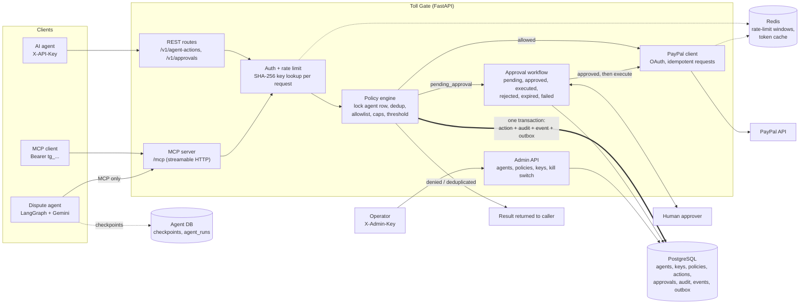

# Toll Gate

A policy gateway between AI agents and PayPal. Agents authenticate with API
keys and *ask permission* to move money; the gateway decides (allow, deny,
require human approval, deduplicate), enforces spending caps atomically,
audits everything, and holds the PayPal credentials so agents never touch
money directly.

## Architecture



One process serves both doorways (REST + MCP); every request re-authenticates
against PostgreSQL and Redis, and every decision lands in one transaction.

Four subsystems, one repo:

- **Policy engine** (PostgreSQL + Redis): agent identity, per-agent policies,
  atomic spending caps, approval workflow, append-only audit log.
- **PayPal client** (`gateway/paypal_client.py`): OAuth2 token acquisition and
  caching (in-memory or Redis-backed), Orders v2 (create/get/capture),
  captures + full/partial refunds, disputes, idempotency via
  `PayPal-Request-Id`, `Decimal` money as strings, typed error hierarchy with
  `debug_id` logging.
- **MCP server** (`gateway/mcp_server.py`, FastMCP): the same gateway exposed
  to AI agents as Model Context Protocol tools over streamable HTTP at
  `/mcp` — money-moving tools run the full policy engine before touching
  PayPal.
- **Dispute agent** (`agent/`): an autonomous LangGraph agent that consumes
  the MCP server as its only doorway — evidence gathering, LLM-drafted
  dispute responses, a hallucination-checking critic, a schema-validated
  refund decision, and a durable interrupt/resume across human approvals.

## Data model (8 tables, `gateway/models.py`)

| Table        | Role |
|--------------|------|
| `agents`     | Who may call the gateway (`name` UNIQUE, `is_active` kill switch) |
| `agent_keys` | API-key SHA-256 hashes, 1:N per agent → zero-downtime key rotation; soft revocation (`revoked_at`) keeps rows for forensics |
| `policies`   | One per agent: `allowed_actions` allowlist, `per_txn_cap`, `rolling_24h_cap`, `approval_threshold`, approval TTL. CHECK: threshold ≤ per-txn cap |
| `actions`    | Every authorization request + verdict (`allowed` / `denied` / `pending_approval` / `deduplicated`) with reason code. `execution_failed_at` marks an allowed action whose PayPal execution definitely failed (releases its rolling-cap reservation; the verdict itself is immutable). Partial unique index `(agent_id, idempotency_key) WHERE outcome <> 'deduplicated'` makes double-spending physically impossible |
| `approvals`  | Human-in-the-loop state machine: `pending → approved → executed`, plus `rejected` / `expired` / `failed`; CHECKs enforce timeline consistency |
| `audit_log`  | Append-only record of **every** decision, including auth failures (nullable `agent_id`). FK with no cascade: audit rows block agent deletion |
| `events`     | Immutable domain-event log (JSONB payloads) |
| `outbox`     | Same events with `status` for a publish relay — written in the decision's transaction, so notifications can't be lost to a crash |

Money is `NUMERIC(12,2)` everywhere; statuses are `TEXT + CHECK` (widening a
CHECK migrates cleanly, unlike `ALTER TYPE`). Schema evolves through Alembic
(`alembic/versions/`, 3 migrations).

## How decisions stay correct under concurrency

`authorize()` (`gateway/policy_engine.py`) takes `SELECT ... FOR UPDATE` on the
agent row first, so concurrent requests from one agent serialize while
different agents never block each other. The rolling 24h cap sums committed
`allowed` actions plus `pending_approval` actions whose approval is still live
— pending approvals *reserve* headroom; rejecting or expiring them releases
it. An `allowed` action whose PayPal execution **definitely** failed (4xx
business rejection — provably not executed) is stamped with
`execution_failed_at` and releases its reservation too; ambiguous failures
(timeouts, 5xx — the money may have moved) keep it, conservatively. Every
decision writes action + audit + event + outbox rows in **one transaction**:
all land or none do. Proven by test: 50 barrier-aligned threads × $10 against
a $100 cap → exactly 10 approvals, total exactly $100.00.

## API

### Agent-facing (auth: `X-API-Key` or `Authorization: Bearer`)

| Endpoint | Purpose |
|---|---|
| `POST /v1/agent-actions` | The decision endpoint. Body: `action_type`, `amount` (decimal **string** — JSON numbers rejected), `currency`, `idempotency_key`, optional `reference_id`. All four outcomes return 200; 4xx means the *request* failed (401/403 auth, 422 validation, 429 rate limit) |
| `GET /v1/actions/{id}` | Action detail (own agent only; foreign ids → 404) |
| `GET /v1/approvals/{id}` | Approval + action detail |
| `POST /v1/approvals/{id}/decision` | `approved` / `rejected` (illegal transitions → 409) |
| `POST /v1/approvals/{id}/execute` | Record execution result: `executed` / `failed` |
| `POST /v1/admin/expire-approvals` | Run the expiry sweep now (pending approvals past `expires_at` → `expired`, releasing cap reservations) |
| `GET /health` | Liveness + `paypal_mode` (never calls PayPal) |

Strict validation (`gateway/schemas.py`): `extra="forbid"` + `strict=True` —
unknown fields, floats-for-money, and malformed values are 422s, mirroring
the DB CHECKs at the edge.

### Admin (auth: `X-Admin-Key` = `ADMIN_API_KEY` env var; unset → 503)

| Endpoint | Purpose |
|---|---|
| `POST /v1/admin/agents` | Provision agent + policy + first key. **Plaintext key returned once, never retrievable again** |
| `PATCH /v1/admin/agents/{id}` | Partial update: the `is_active` kill switch and/or any policy field (allowlist, caps, threshold, TTL). Body needs `actor` (self-reported operator identity, recorded in the audit diff) + ≥1 change field. Deactivation is immediate on every surface — HTTP authorize, all MCP tools, approval execution — and pending approvals are left for the expiry sweep |
| `POST /v1/admin/agents/{id}/keys` | Issue an additional key (rotation: both keys live until the old one is revoked) |
| `DELETE /v1/admin/keys/{key_id}` | Soft-revoke (idempotent). Takes effect on the running server immediately |
| `GET /v1/admin/agents[/{id}]` | Ops views: policy + key prefixes (never hashes) |

The admin credential is deliberately an env-var bootstrap secret, **not** an
agent key — agents cannot provision or approve as admins. Because auth does a
fresh DB read per request, keys issued or revoked and agents deactivated or
re-policed through these endpoints are live on the next request with no
restart (verified with a 50-cycle create→use-immediately hammer). Mutating
handlers **commit before returning** so a client acting instantly on a
response can never outrun the commit. Every mutation is audited
(`agent_created` / `agent_updated` / `key_issued` / `key_revoked`) in the
same transaction as the change; `agent_updated` carries the actor and a
before/after diff of exactly the fields that changed.

### MCP server (`/mcp`, streamable HTTP)

Auth is the same agent API key, sent as `Authorization: Bearer tg_...` (or
`X-API-Key`) on every HTTP request — MCP sessions carry no identity of their
own, so identity is re-resolved (and re-audited on failure) per call.

| Tool | Policy-gated | Purpose |
|---|---|---|
| `get_transaction` | identity only | Fetch a capture by its 17-char ID (status, amount, times) |
| `list_disputes` | identity only | Page through the account's disputes |
| `get_dispute` | identity only | One dispute in full (`PP-D-*` id) |
| `issue_refund` | **full engine** | Refund a capture: allowlist → caps → threshold. `allowed` executes on PayPal immediately with a deterministic `PayPal-Request-Id` (uuid5 of the action id — retries can't double-refund); `pending_approval` creates an approval and moves nothing |
| `create_order` | **full engine** | Create an order (intent=CAPTURE, no money moves); requires `create_order` in the agent's `allowed_actions` |
| `execute_approved_refund` | approval state machine | Executes a refund a human approved (`approved` → PayPal → `executed`/`failed`). Deterministic `PayPal-Request-Id` per action; replaying an executed approval returns the recorded outcome without touching PayPal |

Input schemas are strict: 17-char `[A-Z0-9]` transaction IDs, `PP-D-\d+`
dispute IDs, amounts as positive decimal **strings** (max 2dp), a currency
allowlist (`USD EUR GBP CAD AUD INR`), 8–64-char idempotency keys, and
`additionalProperties: false`. Every result is an envelope
`{"ok": true, "summary": "...", ...}`; denials and pendings are **results**
(`ok: true`, mirroring the HTTP API's "200 for all outcomes"), while auth,
validation, and PayPal failures raise tool errors prefixed with a
`REASON_CODE`. Execution outcomes are audited (`executed` /
`PAYPAL_REFUND_COMPLETED`, `failed` / `PAYPAL_REFUND_FAILED`) and emitted as
`refund.executed` / `refund.failed` events + outbox rows. When a refund's
PayPal execution fails *definitely* (4xx), the action's rolling-cap
reservation is released and the failure audit records
`cap_reservation_released: true`; a same-key replay then reports
`original_execution_failed: true` with a hint to retry under a NEW
idempotency key (decisions replay — they never re-execute).

MCP client configuration (e.g. for any MCP-compatible agent harness):

```json
{"mcpServers": {"tollgate": {
  "url": "http://localhost:8000/mcp",
  "headers": {"Authorization": "Bearer tg_..."}}}}
```

## Dispute agent (`agent/`)

An autonomous agent that handles PayPal disputes end to end. It holds a
regular agent API key (`tg_...`) and talks to the gateway **only** through
the MCP server — it never touches PayPal, the gateway database, or any
state of its own beyond its checkpoints. Every money move therefore passes
the same policy engine, caps, and audit trail as any other agent.

Two generations live side by side:

- `loop_agent.py` — a hand-built prompt→tool-call→tool-output loop
  (registry, Gemini function calling, iteration cap). The mechanics,
  visible.
- `graph.py` — the production shape: a LangGraph `StateGraph`.


The graph only moves forward: every failure branch ends the run with a
terminal status, and only a human approval can wake `execute_refund`.

Guards worth knowing:

- **One-pass critic, no revision loop.** Every 17-char-ID-shaped and
  timestamp-shaped token in the draft must appear verbatim in the evidence
  JSON (deterministic scan), and an LLM fact-check verdict must say
  `supported` — unparseable verdicts fail closed. A rejected draft ends the
  run (`rejected_by_critic`); it is never sent back for rewording, so a
  hallucination cannot be laundered by a rewrite.
- **The decision is a schema, not prose.** `RefundDecision`
  (`extra="forbid"`) enforces the gateway's ID/timestamp regexes, refund > 0
  only with `issue_refund`, cited transaction IDs that exist in the
  evidence, refund ≤ transaction amount, and confidence below the floor ⇒
  `escalate_human`. The floor defaults to 0.6 and is configurable via
  `AGENT_MIN_CONFIDENCE` — a policy default, not a measured value: LLM
  self-reported confidence stays uncalibrated until labeled outcomes
  accumulate (every human approval/escalation is a label). Validation
  failure is a terminal `schema_failed` status.
- **Approval pauses the graph, durably.** `pending_approval` triggers a
  LangGraph `interrupt()`; the state is checkpointed in PostgreSQL
  (`langgraph-checkpoint-postgres`, its own `agent` database). The process
  can die — a fresh process resumes by thread id, calls the gateway's
  `execute_approved_refund`, and finishes. Proven by a test that runs the
  interrupt and the resume in two separate OS processes.
- **Budgets and retries.** Each run gets a `RunMeter`: unique run id, hard
  token budget checked *before* every call, and USD cost from a static
  price table. Transient Gemini failures (429/5xx/network) retry with
  exponential backoff + jitter; 4xx do not.
- Telemetry lands in `agent_runs` (status, in/out tokens, cost, LLM calls,
  plus `confidence` and `proposed_action` — the calibration dataset that
  will let the confidence floor become a measured number) in the agent
  database.

Running it:

```bash
# env: GEMINI_API_KEY, AGENT_API_KEY (the agent's tg_ key), optional:
# AGENT_MODEL (default gemini-3.8-flash), AGENT_MCP_URL, AGENT_DATABASE_URL,
# AGENT_TOKEN_BUDGET, AGENT_PROMPT_VERSION

uv run python -m agent.run_dispute PP-D-56244        # fresh run
# → pauses with an interrupt payload when the gateway demands approval:
#   {"paused": "approval_required", "interrupt": {"approval_id": 4, ...},
#    "resume_with": "uv run python -m agent.run_dispute --resume run-... --approved"}

# human decides the approval via the gateway (POST /v1/approvals/4/decision), then:
uv run python -m agent.run_dispute --resume run-... --approved   # or --rejected
```

Live proof (sandbox, `gemini-3.1-flash-lite`; `gemini-3.8-flash` was
returning 503 high-demand at demo time — the retry ladder with jitter
handled it exactly as designed before the model fallback):

- Loop agent, read task: batched `get_transaction` + `list_disputes` MCP
  calls in one turn, final answer matched the sandbox facts
  (`PARTIALLY_REFUNDED`, 10.99 USD, 0 disputes).
- Loop agent, money task: `issue_refund` 1.00 USD → policy `allowed`
  (action 67, rolling 1.00/50.00) → real sandbox refund
  `3X348304RB917380X` COMPLETED; gateway audit shows `allowed/OK` then
  `executed/PAYPAL_REFUND_COMPLETED`.
- Meter for both tasks: 4 LLM calls, 4,356 in / 247 out tokens,
  **$0.001459**, under the 20k budget.
- CLI graph run against a nonexistent dispute: real gateway
  `RESOURCE_NOT_FOUND` (PayPal `debug_id` included) → terminal
  `evidence_failed` with 0 LLM calls; checkpoint + `agent_runs` rows
  verified in PostgreSQL.

## Requirements

- Python ≥ 3.12, [uv](https://docs.astral.sh/uv/)
- Docker (PostgreSQL 16 + Redis 7) — ports 5433/6380 by default, since native
  services often own 5432/6379 on dev machines
- PayPal sandbox credentials (developer.paypal.com) for payment execution

## Setup

```bash
# infrastructure
docker run -d --name tollgate-pg -e POSTGRES_USER=tollgate -e POSTGRES_PASSWORD=tollgate \
  -e POSTGRES_DB=tollgate -p 5433:5432 postgres:16-alpine
docker run -d --name tollgate-redis -p 6380:6379 redis:7-alpine

# app
uv sync
cp .env.example .env    # fill PayPal creds; generate ADMIN_API_KEY:  tga_$(openssl rand -hex 24)
uv run alembic upgrade head
uv run uvicorn main:app --port 8000
```

## Usage

Provision an agent (via API, or the CLI equivalent
`uv run python scripts/create_agent.py <name> [per_txn] [rolling_24h] [threshold] [ttl_min] [actions...]`):

```bash
curl -s -X POST localhost:8000/v1/admin/agents \
  -H "X-Admin-Key: $ADMIN_API_KEY" -H 'Content-Type: application/json' \
  -d '{"name":"refund-bot","allowed_actions":["refund"],
       "per_txn_cap":"25.00","rolling_24h_cap":"100.00","approval_threshold":"20.00"}'
# → {"agent_id":1,"api_key":"tg_...","key_id":1,"key_prefix":"tg_..."}   (key shown once)
```

Request a decision:

```bash
curl -s -X POST localhost:8000/v1/agent-actions \
  -H "X-API-Key: tg_..." -H 'Content-Type: application/json' \
  -d '{"action_type":"refund","amount":"22.00","idempotency_key":"req-0001"}'
# → {"outcome":"pending_approval","reason_code":"APPROVAL_REQUIRED","approval_id":1,...}
# replaying the same idempotency_key → {"outcome":"deduplicated","original_outcome":...}
```

Decide and execute the approval:

```bash
curl -s -X POST localhost:8000/v1/approvals/1/decision \
  -H "X-API-Key: tg_..." -H 'Content-Type: application/json' \
  -d '{"decision":"approved","decided_by":"ops-alice"}'
curl -s -X POST localhost:8000/v1/approvals/1/execute \
  -H "X-API-Key: tg_..." -H 'Content-Type: application/json' \
  -d '{"executed":true}'
```

PayPal end-to-end sandbox flow (create order → approve in browser → capture →
partial refund → idempotent replay; refuses to run outside sandbox):

```bash
uv run python scripts/toll_flow.py
```

Call a tool over MCP with raw HTTP (streamable HTTP is plain JSON-RPC;
`initialize` returns an `mcp-session-id` header to reuse):

```bash
curl -si -X POST localhost:8000/mcp \
  -H "Content-Type: application/json" -H "Accept: application/json, text/event-stream" \
  -H "Authorization: Bearer tg_..." \
  -d '{"jsonrpc":"2.0","id":1,"method":"initialize","params":{"protocolVersion":"2025-03-26","capabilities":{},"clientInfo":{"name":"curl","version":"1.0"}}}'
# → 200, header mcp-session-id: 3ee57961..., body: serverInfo {"name":"tollgate"}

curl -s -X POST localhost:8000/mcp \
  -H "Content-Type: application/json" -H "Accept: application/json, text/event-stream" \
  -H "Authorization: Bearer tg_..." -H "mcp-session-id: 3ee57961..." \
  -d '{"jsonrpc":"2.0","id":2,"method":"tools/call","params":{"name":"issue_refund","arguments":{"capture_id":"05Y454980K6595141","amount":"1.50","currency":"USD","idempotency_key":"mcp-live-refund-001"}}}'
# → {"result":{"content":[{"text":"{\"ok\":true,\"summary\":\"Refund 92F13256LW3371821 executed: 1.50 USD ...\"}"}],"isError":false}}
```

Verified live against the PayPal sandbox: a $22 refund went
`pending_approval` (approval created, PayPal untouched) and a $1.50 refund
executed end-to-end (real refund `92F13256LW3371821`, audit rows
`allowed` → `executed`, events + outbox written).

## Tests

```bash
uv run pytest        # 135 tests, ~3 min — requires the Docker containers running
```

Runs against a real PostgreSQL test database (`tollgate_test`, created and
Alembic-migrated automatically by `tests/conftest.py`, truncated between
tests) because the correctness claims under test — `SELECT FOR UPDATE`
serialization, partial unique indexes, CHECK constraints — are PostgreSQL
behavior. Coverage: policy outcomes and caps, dedup, approval lifecycle and
expiry, 50-thread concurrency (allowed path and pending-reservation path),
API auth/validation/rate-limiting, admin provisioning, key rotation, and the
agent-update endpoint (kill switch + live policy changes, audit diffs). The
PayPal client is tested offline via `httpx.MockTransport` (token refresh,
error mapping). The MCP server is tested end-to-end against a real uvicorn
thread server and a real MCP client over streamable HTTP: discovery,
unauthorized calls (missing/invalid/revoked keys, audited), invalid
parameters, denied/pending/deduplicated/allowed-executed refunds,
approved-refund execution (incl. replay idempotence, ownership, and
PayPal-failure → `failed`), cap reservation across tools, cap release on
definite execution failures (ambiguous failures keep the reservation), and
PayPal-failure auditing — with a MockTransport PayPal injected through the
same `init_paypal_client()` seam `main.py` uses.

The agent is tested without network: `ScriptedLLM`/`FakeLLM` script Gemini
(including retry/backoff/jitter behavior against real `google.genai.errors`
exceptions) and `FakeRegistry` scripts the gateway — but the LangGraph
checkpointer is **real PostgreSQL** (`agent_test` database). The durability
test runs the graph to the approval interrupt in a subprocess, lets the
process exit, and resumes in a second subprocess: state is carried by
PostgreSQL alone.


## Project layout

```
config.py               env-driven settings (PayPal, DB, Redis, rate limits, admin key)
main.py                 FastAPI app, lifespan (PayPal client w/ Redis token cache,
                        MCP session manager), MCP sub-app mounted at /mcp
gateway/
  paypal_client.py      PayPal REST client (pluggable TokenCache)
  models.py             the 8 tables + vocabularies + transition map
  db.py                 engine, session_scope (transaction contract)
  api_keys.py           key generation + SHA-256 hashing
  auth.py               request pipeline: get_db → auth → rate limit
  policy_engine.py      authorize(): lock, dedup, caps, threshold, outcomes
  approvals.py          state machine, expiry sweep
  audit.py              append-only writer (insert is the only operation)
  redis_client.py       token cache + fixed-window rate limits
  schemas.py            strict Pydantic request/response models
  routes.py             agent-facing endpoints
  admin.py              admin endpoints (create/patch agents, keys, views)
  mcp_server.py         MCP tools (streamable HTTP), header auth, PayPal execution glue
alembic/                migrations (schema → perf index → agent_keys)
agent/
  config.py             env-driven agent settings (MCP url, keys, model, budget)
  gemini_client.py      Gemini wrapper: backoff+jitter, error classes, metering
  budget.py             RunMeter: run id, token budget, USD cost table
  tools.py              tool registry + MCP bridge (errors are data, never raises)
  loop_agent.py         hand-built prompt/tool loop with iteration cap
  prompts.py            versioned prompt loader (fail-loud)
  prompts/v1/           loop system, draft, critic, decision prompts
  state.py              AgentState + RefundDecision/CitedEvidence schemas
  graph.py              LangGraph: nodes, critic guards, routing, interrupt
  checkpoint.py         agent-database bootstrap + PostgresSaver
  runs.py               agent_runs telemetry table (upsert)
  run_dispute.py        CLI: fresh runs + --resume --approved/--rejected
  testing.py            ScriptedLLM/FakeRegistry + canned gateway envelopes
scripts/
  create_agent.py       CLI provisioning (prints key once)
  toll_flow.py          live PayPal sandbox end-to-end demo
tests/                  135 tests (real Postgres + MockTransport + real MCP over HTTP
                        + scripted-LLM agent tests + cross-process resume proof)
```

## License

MIT — see [LICENSE](LICENSE).
